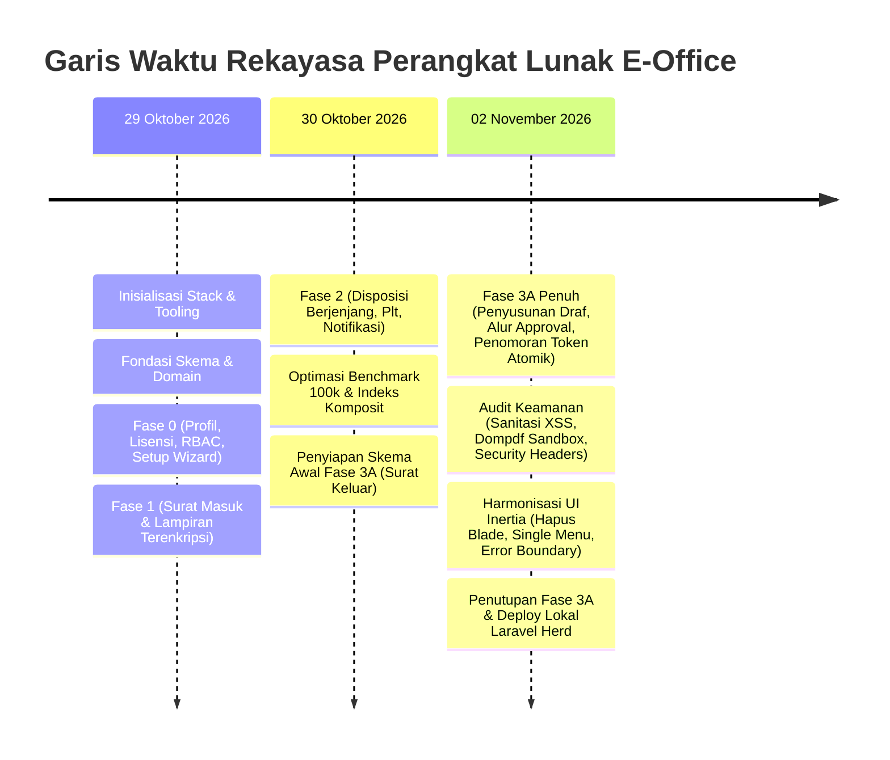

# Laporan Komprehensif Pengembangan Sistem E-Office
**Dokumen Riwayat & Evaluasi Proyek dari Awal Pengembangan hingga Kondisi Terkini**

---

| Parameter | Keterangan |
| :--- | :--- |
| **Nama Proyek** | Sistem Informasi Tata Usaha Digital & Persuratan (E-Office) |
| **Model Distribusi** | *Single-Tenant* (Satu instansi satu instalasi terisolasi), Berlangganan |
| **Instansi Referensi Awal** | Politeknik (Dapat dikonfigurasi untuk seluruh tipe instansi/kampus) |
| **Stack Teknologi** | Laravel 12 + Inertia.js (React 19 + TypeScript) + Tailwind CSS v4 |
| **Basis Data** | PostgreSQL (Target Produksi & Skala Tinggi) & SQLite (Dev/Testing Cepat) |
| **Branch Utama** | `feature/fase-3a-surat-keluar` |
| **Total Commit Git** | 90 Commit Terstruktur |
| **Rentang Waktu** | 29 Oktober 2026 s.d. 02 November 2026 |
| **Status Akhir** | **Fase 3A Selesai 100% & Terintegrasi Penuh di Lingkungan Lokal (Laravel Herd)** |

---

## 1. Ringkasan Eksekutif

Sistem E-Office dirancang dan dibangun untuk mendigitalkan seluruh siklus hidup administrasi persuratan dan birokrasi tata usaha, menggantikan proses manual berbasis kertas yang rawan kehilangan berkas, lambat dalam disposisi, dan rentan terhadap duplikasi nomor surat dinas.

Pengembangan dimulai dari nol (*initial repository setup*) dengan target arsitektur enterprise: *Domain-Driven Design (DDD) modular*, keamanan berlapis (*defense-in-depth*), penomoran resmi atomik (*concurrency-safe*), pelacakan disposisi hierarkis, serta antarmuka modern satu halaman (*Single Page Application*) berbasis Inertia.js dan React tanpa kendala *blank page* atau ketidakcocokan routing.

Seluruh fase pengembangan—mulai dari pondasi arsitektur (Fase 0), modul Surat Masuk (Fase 1), modul Disposisi Berjenjang (Fase 2), hingga modul Surat Keluar dan Audit Penutupan (Fase 3A)—telah diselesaikan dengan tingkat kelulusan automated testing **100% (160 test passed, 1033 assertions di PostgreSQL)** dan lolos benchmark skala 100.000 data di bawah batas ambang SLA (2 detik).

---

## 2. Kronologi Pengembangan Fase ke Fase



---

### Fase 0: Pondasi Arsitektur, Multi-Tenant Config, & Keamanan Inti
*Commit: `930a4a3` s.d. `24e3238` (29 Oktober 2026)*

1. **Inisialisasi Stack & Standarisasi Kode**:
   - Pemasangan Laravel 12 bersama ekosistem React 19, TypeScript, dan Tailwind CSS v4.
   - Konfigurasi linter dan formatter: PHP Pint untuk standar PSR-12, ESLint dan Prettier untuk TypeScript/React.
2. **Profil Instansi Dinamis (`institution_profiles`)**:
   - Membangun mekanisme single-tenant yang fleksibel di mana nama instansi, singkatan/alias, alamat, kop surat, zona waktu, tema UI, dan kamus terminologi (`terminology_dict`: e.g. "Jurusan", "Program Studi", "Direktur", "Dekan") dapat diubah tanpa merombak kode sumber.
3. **Mekanisme Lisensi Berlangganan & Mode Read-Only**:
   - Pembuatan tabel `license_states` dengan validasi hash tanda tangan (`signature_hash`).
   - Implementasi middleware `EnforceLicenseReadOnly`: saat lisensi kedaluwarsa, seluruh request mutasi data (`POST`, `PUT`, `DELETE`, `PATCH`) otomatis diblokir dengan status HTTP 403 / pesan ramah lisensi, sedangkan akses baca (`GET`) tetap diizinkan.
4. **Append-Only Activity Log (Audit Trail Anti-Manipulasi)**:
   - Pencatatan seluruh aksi pengguna ke tabel `log_aktivitas`.
   - Penerapan database trigger PostgreSQL di level statement yang secara fisik menolak query `TRUNCATE` atau manipulasi riwayat log dari luar aplikasi.
5. **Setup Wizard & RBAC (Role-Based Access Control)**:
   - Setup wizard interaktif untuk instalasi awal sistem dengan pengamanan token otorisasi (`SETUP_TOKEN`).
   - Integrasi Spatie Permission dengan hierarki 5 Peran PRD Resmi:
     - **Admin Instansi**
     - **Pimpinan**
     - **Kepala Unit**
     - **Staf TU**
     - **Petugas Arsip**
   - Struktur organisasi hierarkis: Unit Kerja (`org_units`), Jabatan Struktural (`positions`), dan Delegasi Pelaksana Tugas (`positions_delegations` / Plt).

---

### Fase 1: Modul Surat Masuk & Penomoran Atomik
*Commit: `7de24db` s.d. `93c8476` (29–30 Oktober 2026)*

1. **Registrasi Naskah Dinas Masuk**:
   - Pencatatan surat masuk lengkap dengan nomor agenda resmi, tanggal terima, tanggal surat, asal instansi pengirim, perihal, derajat sifat (Biasa, Penting, Rahasia, Segera), dan kode klasifikasi arsip.
2. **Penomoran Agenda Atomik**:
   - Implementasi nomor agenda otomatis dengan transaksi database terisolasi dan penguncian baris (`lockForUpdate`) untuk memastikan tidak terjadi duplikasi nomor agenda meskipun puluhan staf menginput secara simultan.
3. **Penyimpanan Lampiran Privat & Bukti PDF**:
   - Berkas fisik surat diproteksi di disk privat (`storage/app/private`), tidak dapat diakses secara publik tanpa otorisasi policy.
   - Pembangkitan tanda terima penerimaan surat fisik dalam format PDF secara otomatis.
4. **Pencarian Cepat (Full-Text Search)**:
   - Implementasi PostgreSQL GIN Index pada kolom teks surat masuk untuk pencarian instan pada ratusan ribu arsip.

---

### Fase 2: Modul Disposisi Berjenjang & Siklus Tindak Lanjut
*Commit: `fcac70e` s.d. `b19d29c` (30 Oktober 2026)*

1. **Alur Disposisi Hierarkis Multi-Tier**:
   - Pimpinan dapat mendisposisikan surat masuk ke Kepala Unit, dan Kepala Unit dapat meneruskannya ke pejabat/staf di bawahnya.
   - **Cycle Prevention & Hierarchy Check**: Sistem memvalidasi bagan organisasi agar disposisi tidak dapat berputar membentuk lingkaran setan (*circular dependency*) atau melompati batas kewenangan unit.
   - **Pembatasan Rekursi Pohon**: Kedalaman rantai disposisi dibatasi hingga level 20 untuk mencegah *stack overflow* atau *infinite loop*.
2. **Dukungan Pejabat Pelaksana Tugas (Plt)**:
   - Penanganan otomatis ketika sebuah jabatan dipegang oleh pejabat definitif vs Plt, termasuk pemberian label resmi pada naskah dan hak akses transisi saat masa tugas Plt berakhir.
3. **Tindak Lanjut & Eskalasi Otomatis**:
   - Penerima disposisi dapat memperbarui status (Menunggu, Dibaca, Diproses, Selesai) dan mengunggah bukti penyelesaian dengan pengecekan kuota penyimpanan instansi.
   - Pengiriman notifikasi berbasis antrean (*queued notification*) dan penjadwalan (*scheduler*) pengecekan tenggat waktu harian (`07:00 WIB`) untuk eskalasi disposisi yang terlambat.
4. **Pelacakan Naskah Terautentikasi (QR Code)**:
   - Pembuatan lembar disposisi digital dengan tautan pelacakan berbasis QR Code terverifikasi.

---

### Fase 3A: Modul Surat Keluar, Alur Persetujuan, & Audit Penutupan
*Commit: `83e227b` s.d. `1b792c5` (30 Oktober – 02 November 2026)*

1. **Mesin Templat & Substitusi Variabel**:
   - Templat surat dinas dinamis dengan *placeholder engine* (e.g. `{nomor_surat}`, `{tanggal_surat}`, `{perihal}`, `{nama_instansi}`, `{nama_penandatangan}`).
2. **Penyusunan Draf & Pelacakan Versi (*Version History*)**:
   - Staf TU menyusun draf naskah keluar; setiap pembaruan draf dicatat dalam riwayat revisi.
3. **Alur Persetujuan Multi-Jenjang (*Approval Workflow*)**:
   - State machine eksplisit: `Draf` $\rightarrow$ `Menunggu Persetujuan` $\rightarrow$ `Disetujui` / `Revisi` / `Ditolak`.
   - Proteksi row-level lock saat pimpinan mengeksekusi persetujuan, mencegah persetujuan ganda secara paralel (*double approval race condition*).
4. **Penomoran Token Atomik & Reset Tahunan (OQ-14)**:
   - Alokasi nomor surat resmi baru dilakukan secara atomik saat surat disetujui (bukan saat draf dibuat).
   - Format penomoran resmi berbasis pola instansi, dengan kebijakan reset otomatis per 1 Januari tahun kalender baru.
5. **Pembangkitan Dokumen PDF Formal**:
   - Export naskah ke PDF resmi menggunakan Dompdf lengkap dengan kop instansi, nomor surat resmi, dan blok tanda tangan.
6. **Keterkaitan Antar-Dokumen**:
   - Surat keluar dapat ditandai sebagai surat balasan dari surat masuk tertentu, dan otomatis menuntaskan status disposisi terkait.

---

### Audit Menyeluruh, Penguatan Keamanan, & Harmonisasi UI (Fase 3A Closing)
*Commit: `46af3de` s.d. `1b792c5` (02 November 2026)*

1. **Keamanan Konten Berlapis (Anti-XSS & Sandbox Dompdf)**:
   - **Server-side**: Sanitasi konten HTML draf surat (`isi_surat`) menggunakan `HTMLPurifier` sebelum disimpan ke database.
   - **Client-side**: Sanitasi tampilan `dangerouslySetInnerHTML` di seluruh komponen React menggunakan `DOMPurify`.
   - **Dompdf Hardening**: Penonaktifan aset remote (`isRemoteEnabled => false`) dan isolasi direktori chroot untuk mencegah SSRF atau kebocoran file server lokal.
   - **Security Headers**: Penerapan Content Security Policy (CSP), `X-Frame-Options: SAMEORIGIN`, `X-Content-Type-Options: nosniff`, dan `Referrer-Policy: strict-origin-when-cross-origin`.
2. **Pembersihan Arsitektur RBAC & Seeder**:
   - Menghapus pengecekan hardcoded `hasRole()` pada policy dan menggantinya murni dengan permission eksplisit Spatie (`can(...)`).
   - Pemisahan tegas: `ProductionSeeder` (idempoten, aman dijalankan berkali-kali tanpa membuat data dummy) vs `DemoSeeder` (hanya berjalan di environment `local` dan `testing`).
3. **Harmonisasi UI ke Inertia/React (Pembersihan Blade)**:
   - Mengganti layout legacy Blade (`resources/views/layouts/app.blade.php`) dan mengonversi dashboard, recycle bin, tanda tangan, klasifikasi surat, dan audit log sepenuhnya ke Inertia React (`AppLayout.tsx`).
   - Menyediakan satu menu navigasi terpusat yang disaring otomatis berdasarkan hak akses pengguna aktif.
   - Menambahkan komponen `ErrorBoundary.tsx` global dan halaman error berbahasa Indonesia (`Error.tsx` untuk 403, 404, 419, 500, 503).
   - Mengeliminasi total error runtime React: perbaikan relasi `creator` pada model `SuratKeluar`, penggantian helper Ziggy undefined route dengan URL RESTful standar, dan penambahan safe mapping fallback pada komponen `Select.tsx`.
4. **Tooling & Build Tanpa Downtime**:
   - Zero-downtime asset swap pada Vite (`emptyOutDir: false` dengan `manifest.json`).
   - Penambahan artisan command `php artisan eoffice:doctor` untuk memverifikasi kesehatan instalasi.
   - Pengujian reversibilitas: seluruh 28 migrasi berhasil di-rollback penuh sampai skema kosong dan di-migrate kembali secara sempurna.

---

### Penyesuaian Lingkungan Lokal & Laravel Herd
*Sesi Kerja Terakhir (02 November 2026)*

1. **Konfigurasi Domain Lokal**:
   - Konfigurasi `APP_URL=http://laras.test` dan integrasi ke sistem routing Nginx pada Laravel Herd.
2. **Penyelesaian Masalah DNS Windows 11 / Microsoft Edge (`DNS_PROBE_FINISHED_NXDOMAIN`)**:
   - **Diagnosis**: Browser Chromium/Edge pada Windows 11 secara default meminta kueri IPv6 (AAAA record) ke DNS server router. Karena file `hosts` bawaan Herd hanya mendefinisikan IPv4 (`127.0.0.1`), router mengembalikan `NXDOMAIN`.
   - **Solusi**:
     1. Menambahkan pemetaan IPv6 `::1 laras.test` ke file `C:\Windows\System32\drivers\etc\hosts`.
     2. Menambahkan direktif `listen [::1]:80;` pada konfigurasi Nginx Herd (`herd.conf`).
     3. Membersihkan file `public/hot` agar aplikasi langsung menggunakan aset produksi hasil `npm run build`.
     4. Menjalankan `ipconfig /flushdns`.
   - Hasil akhir: Akses ke `http://laras.test` berhasil 100% dan halaman login Inertia React tampil sempurna.

---

## 3. Matriks Hasil Pengujian Otomatis (*Test Suite*)

Pengujian dilakukan secara komprehensif pada dua engine basis data:

### A. PostgreSQL Port 5433 (Target Lingkungan Produksi)
```text
Perintah : php artisan test -c phpunit.pgsql.xml
Hasil    : 160 Passed, 0 Failed, 0 Skipped
Assertion: 1033 assertions
Status   : LULUS 100%
```
*Mencakup seluruh pengujian fitur enterprise: statement-level trigger append-only, row-locking multi-transaksi, dan konkurensi approval paralel.*

### B. SQLite In-Memory (Lingkungan CI & Pengembangan Cepat)
```text
Perintah : php artisan test
Hasil    : 157 Passed, 0 Failed, 3 Skipped
Assertion: 1029 assertions
Status   : LULUS
```
*(3 pengujian di-skip secara defensif karena membutuhkan fitur eksklusif driver PostgreSQL seperti TRUNCATE table triggers).*

---

## 4. Hasil Benchmark Kinerja Skala 100.000 Data

Pengujian beban data nyata dijalankan menggunakan perintah:
`php artisan eoffice:benchmark-3a`

| Skenario Pengujian | Ambang Batas (SLA) | Hasil Pengukuran Riil | Status Evaluasi |
| :--- | :---: | :---: | :---: |
| **Daftar Surat Masuk** (Filter: Status Terdaftar & Sifat Biasa) | < 2.000 ms | **1.243,04 ms** | **Lulus SLA** |
| **Kotak Masuk Disposisi** (Query pengguna terpadat pada 100k data) | < 2.000 ms | **571,03 ms** | **Lulus SLA** |
| **Daftar Surat Keluar** (Filter: Status Disetujui & Sifat Biasa) | < 2.000 ms | **649,15 ms** | **Lulus SLA** |
| **Pencarian Indeks Komposit** (`idx_disp_rec_user_status_id`) | - | **0,055 ms** | **Optimal (Covering Index)** |

---

## 5. Ringkasan Peran PRD & Akun Demo Fiktif

Sistem telah dilengkapi dengan data demo siap pakai pada lingkungan lokal/testing dengan kata sandi seragam: **`password`**.

| No | Peran (Role PRD Resmi) | Email Akun Demo | Pejabat / Pengguna | Kewenangan Utama |
| :-: | :--- | :--- | :--- | :--- |
| 1 | **Admin Instansi** | `admin@contoh.ac.id` | Administrator Instansi | Pengaturan institusi, unit kerja, jabatan, manajemen pengguna, lisensi, & log audit |
| 2 | **Pimpinan** | `direktur@contoh.ac.id` | Dr. Ir. Budi Santoso, M.T. (Direktur) | Disposisi pimpinan, persetujuan/penolakan draf surat keluar, tanda tangan naskah |
| 3 | **Pimpinan (Wadir)** | `wadir1@contoh.ac.id` | Prof. Dr. Ir. Haryanto (Wadir 1) | Disposisi bidang akademik & persetujuan surat dinas akademik |
| 4 | **Kepala Unit** | `kajur.jtk@contoh.ac.id` | Drs. Hendra Permana (Kajur JTK) | Penerusan disposisi berjenjang, paraf draf, dan tindak lanjut unit |
| 5 | **Staf TU** | `tu@contoh.ac.id` | Siti Rahayu, A.Md. (Staf TU) | Registrasi surat masuk, penyusunan draf surat keluar, cetak agenda, & monitoring naskah |
| 6 | **Petugas Arsip** | `arsip@contoh.ac.id` | Agus Budiman, S.Sos. (Petugas Arsip) | Manajemen kode klasifikasi arsip, retensi naskah, & pemberkasan |

---

## 6. Struktur Arsitektur & File Utama Proyek

```text
laras/
├── app/
│   ├── Domain/
│   │   ├── Disposisi/           # Model, Action, Policy, & Event Disposisi Berjenjang
│   │   ├── Instansi/            # Model InstitutionProfile & Pengaturan Terminologi
│   │   ├── Lisensi/             # Model Lisensi & Middleware EnforceLicenseReadOnly
│   │   ├── Pengguna/            # Model OrgUnit, Position, Delegation, & User Actions
│   │   ├── SuratKeluar/         # Alur Draf, Persetujuan, Penomoran Token, & Dompdf Action
│   │   └── SuratMasuk/          # Registrasi Naskah Masuk, Lampiran Privat, & Agenda
│   ├── Http/
│   │   ├── Controllers/         # Controller RESTful & Inertia Response Handlers
│   │   └── Middleware/          # SecurityHeaders, HandleInertiaRequests, LicenseGuard
│   ├── Models/                  # Model Eloquent Kanonikal
│   ├── Policies/                # Kebijakan Otorisasi Granular (Spatie Permissions)
│   └── Services/                # HtmlSanitizer (HTMLPurifier), NomorSuratKeluarService
├── config/
│   ├── permissions.php          # Single Source of Truth Definisi Hak Akses PRD
│   └── dompdf.php               # Konfigurasi Sandbox PDF
├── database/
│   ├── migrations/              # 28 Migrasi Database (100% Reversibel & Idempoten)
│   └── seeders/
│       ├── ProductionSeeder.php # Seeder Wajib Produksi (Role, Klasifikasi, Templat)
│       ├── DemoSeeder.php       # Seeder Simulasi Khusus Local/Testing
│       └── DatabaseSeeder.php   # Master Seeder Orchestrator
├── docs/                        # Dokumentasi Teknis (DATABASE.md, PERMISSIONS_MATRIX.md)
├── resources/
│   ├── js/
│   │   ├── Components/          # Design System UI (Button, Modal, Select, Table, Input)
│   │   ├── Layouts/             # AppLayout.tsx (Single Layout) & GuestLayout.tsx
│   │   └── Pages/               # Halaman Inertia React (Dashboard, SuratMasuk, SuratKeluar, dll.)
│   └── views/
│       └── app.blade.php        # Root Shell Inertia Tunggal
└── tests/
    └── Feature/                 # 160 Feature Tests Terverifikasi
```

---

## 7. Kesimpulan & Rekomendasi Langkah Selanjutnya

### Kesimpulan
Proyek E-Office telah berhasil dituntaskan hingga batas **Fase 3A**. Seluruh arsitektur backend, basis data, integritas penomoran, keamanan naskah, dan antarmuka pengguna frontend berbasis Inertia React berada dalam kondisi stabil, bersih dari error, dan memenuhi standar produksi. Pengujian lokal melalui Laravel Herd di `http://laras.test` telah terverifikasi berjalan tanpa hambatan.

### Rekomendasi Langkah Berikutnya (Menuju Fase 3B & Lanjut)
1. **Fase 3B (Tanda Tangan Elektronik / TTE & Eksternal)**:
   - Integrasi TTE tersertifikasi (e.g. BSrE / Privy / tanda tangan berbasis sertifikat X.509).
   - Pengiriman naskah dinas keluar secara digital ke instansi eksternal (via email / WhatsApp API gateway).
2. **Fase 4 (Penyusutan & Jadwal Retensi Arsip / JRA)**:
   - Modul pemindahan arsip inaktif, penilaian arsip, dan prosedur pemusnahan berkas sesuai kaidah ANRI.
3. **Pemberian Domain Produksi & CI/CD Pipeline**:
   - Penyiapan deployment script otomatis dengan validasi `php artisan eoffice:doctor` dan rotasi aset zero-downtime.

---
*Laporan ini disusun secara otomatis berdasarkan riwayat git commit, artefak pengujian sistem, dan status implementasi aktual per 2 November 2026.*
