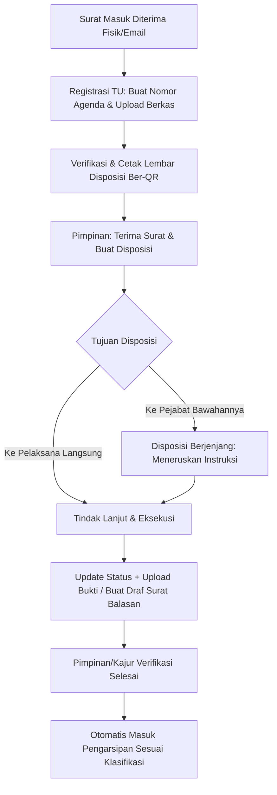
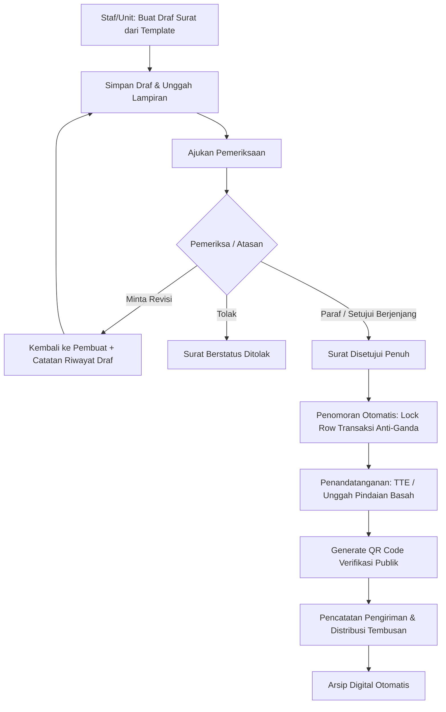

# Arsitektur Sistem E-Office (Single-Tenant Berlangganan)

Dokumen ini mendefinisikan arsitektur teknis, struktur direktori, prinsip desain, dan alur data utama aplikasi E-Office berdasarkan spesifikasi PRD (`e-office.md`).

---

## 1. Prinsip Desain & Keputusan Arsitektur

### 1.1 Single-Tenant per Instalasi
* **Tanpa `tenant_id`:** Setiap instansi memiliki instalasi terisolasi (1 database, 1 container app, 1 media storage terpisah).
* **Isolasi Penuh:** Menghilangkan risiko kebocoran data antar-instansi (*cross-tenant data leak*) dan menyederhanakan query database serta performa indexing.
* **Struktur Internal Multi-Unit:** Hierarki fakultas/jurusan/prodi/bagian dikelola di dalam satu instansi melalui tabel `org_units` dan `positions`.

### 1.2 Konfigurasi Penuh Tanpa Modifikasi Kode (Configurable & Dynamic)
* Seluruh elemen spesifik instansi disimpan dalam basis data:
  - **Identitas & Branding:** Nama instansi, logo, kop surat resmi, warna tema, zona waktu (WIB/WITA/WIT).
  - **Kamus Istilah Dinamis (*Terminology Dictionary*):** Label jabatan dan unit dapat disesuaikan (misal: "Kajur" $\leftrightarrow$ "Kabid", "Direktur" $\leftrightarrow$ "Rektor" $\leftrightarrow$ "Kepala Lembaga"). Frontend menggunakan helper terpusat `t_term('jurusan')` untuk merender label.
  - **Pola Penomoran Berbasis Token:** `{urut}/{kode_unit}/{kode_klasifikasi}/{bulan_romawi}/{tahun}` dapat disesuaikan per jenis surat.

### 1.3 Arsitektur Modular Berbasis Domain (Domain-Driven Organization)
Logika bisnis diletakkan pada layer Domain, bukan menumpuk di Controller:
```
app/
├── Domain/
│   ├── Instansi/           # Profil instansi, branding, kamus istilah
│   ├── Pengguna/           # Pengguna, unit kerja, jabatan, RBAC
│   ├── SuratMasuk/         # Registrasi, nomor agenda, disposisi awal
│   ├── Disposisi/          # Alur disposisi berjenjang, instruksi, tindak lanjut
│   ├── SuratKeluar/        # Template, draf, persetujuan/paraf, penomoran, TTD
│   ├── Arsip/              # Klasifikasi arsip, retensi (JRA), log retensi
│   ├── Lisensi/            # Entitlement, license check, mode read-only
│   └── Audit/              # Log aktivitas append-only
```
* **Controller Tipis:** Hanya menangani routing HTTP, validasi Form Request, memanggil Action/Service, dan mengembalikan response Inertia atau JSON.
* **Action / Service Class:** Mengeksekusi satu alur transaksi bisnis (contoh: `GenerateLetterNumberAction`, `CreateDisposisiAction`, `ApproveSuratKeluarAction`).

### 1.4 Audit Trail Append-Only
* Tabel `activity_logs` dirancang secara *append-only*.
* Larangan `UPDATE` dan `DELETE` di level Model Eloquent (via model events / exceptions) dan database triggers.
* Menyimpan `causer_id`, `subject_type`, `subject_id`, `action`, `properties` (diff data sebelum/sesudah), IP address, dan User Agent.

### 1.5 Enkapsulasi Lisensi & Mode Baca-Saja (Data Tidak Boleh Disandera)
* Middleware terpusat `CheckLicenseEntitlement` memeriksa status lisensi:
  - **Aktif:** Akses penuh sesuai paket (Dasar, Standar, Lanjutan).
  - **Grace Period (Masa Tenggang):** Peringatan di UI, fungsi tetap berjalan.
  - **Expired (Kadaluwarsa):** Akses otomatis beralih ke **Mode Baca-Saja (Read-Only) + Ekspor Penuh**. Operasi write (POST/PUT/DELETE) ditolak kecuali ekspor arsip/data dan pembaruan lisensi oleh Admin Instansi.
  - **Kuota Penuh:** Hanya membatasi penambahan user baru atau unggahan file baru.

### 1.6 Mobile-First untuk Pimpinan
* Alur pimpinan dioptimalkan untuk smartphone:
  - Melihat daftar disposisi/surat butuh persetujuan.
  - Membaca dokumen/lampiran secara instan.
  - Melakukan aksi disposisi cepat, paraf, atau tanda tangan dalam $\le$ 3 ketukan layar.

### 1.7 Pustaka Terpilih: QR Code & Generator PDF
* **QR Code Engine: `simplesoftwareio/simple-qrcode` (BaconQrCode)**
  - *Alasan Pemilihan:* Menghasilkan output SVG vektor dan PNG secara *in-memory* tanpa dependensi biner eksternal atau subprocess shell. Vektor SVG tidak pecah saat dicetak pada kop surat beresolusi tinggi, dapat di-embed langsung ke template Blade DomPDF, dan aman dari kerentanan injeksi shell perintah luar.
* **PDF Generation Engine: `barryvdh/laravel-dompdf` (Dompdf)**
  - *Alasan Pemilihan:* Render langsung dari view Blade standar Laravel dengan dukungan CSS paged media (`@page { size: A4 portrait; margin: 15mm; }`). Sangat portabel di semua sistem operasi (Windows Herd, Linux, Docker) tanpa memerlukan browser headless (Chromium/Puppeteer) atau wkhtmltopdf yang sering terhalang kebijakan keamanan server institusi. Berkas PDF bukti terima dan lembar disposisi yang dihasilkan berukuran sangat efisien (30–80 KB) sehingga hemat penyimpanan dan cepat dimuat pada jaringan mobile.

### 1.8 Matriks Otorisasi Akses & Visibilitas Disposisi (Perlindungan Anti-IDOR)
Untuk mencegah kebocoran data antar-unit (*Insecure Direct Object References / IDOR*), visibilitas satu lembar disposisi dan berkas bukti tindak lanjut dibatasi secara ketat pada Policy:
1. **Pembuat Disposisi (*Pemberi*):** Pengguna dengan `disposisi.buat` yang menerbitkan lembar disposisi (`pemberi_id = user.id`) berhak melihat naskah dan memantau status pelaksanaan seluruh penerima di bawahnya.
2. **Penerima Disposisi (*Definitif & Plt*):** Pengguna yang ditunjuk (`recipient_user_id = user.id`) atau pejabat pelaksana tugas aktif (`delegated_user_id = user.id`) berhak melihat lembar disposisi, mengunduh lampiran asli & lampiran bukti, serta memberikan catatan tindak lanjut.
3. **Rantai Leluhur (*Ancestor Chain*):** Pejabat atasan dalam rantai hierarki penerusan (misal: Direktur yang mendisposisikan ke Kajur, lalu diteruskan ke Kaprodi) tetap berhak melihat perkembangan disposisi tingkat anak (*child dispositions*).
4. **Rantai Turunan (*Descendant Chain*):** Penerima di tingkat bawah berhak menelaah riwayat instruksi dari pejabat-pejabat di atasnya (*parent history chain*) untuk memahami konteks arahan pimpinan tertinggi.
5. **Admin / Pengelola Persuratan Institusional:** Pengguna dengan izin khusus `disposisi.kelola` atau `organisasi.kelola` (Admin Instansi / Staf Tata Usaha berizin) memiliki hak supervisi global untuk keperluan penatausahaan kearsipan.
6. **Pengguna di Luar Keterlibatan (*Unrelated Users*):** Ditolak dengan status **403 Forbidden**. Sistem menolak akses membuka detail disposisi, mengunduh berkas lampiran bukti lewat manipulasi ID pada URL langsung, maupun melacak surat di luar unit/haknya melalui token QR.

---

## 2. Diagram Alur Sistem (Mermaid)

### 2.1 Alur Siklus Surat Masuk & Disposisi Berjenjang



### 2.2 Alur Siklus Surat Keluar & Persetujuan (Approval)



---

## 3. Struktur Direktori Proyek

```
laras/
├── app/
│   ├── Domain/
│   │   ├── Instansi/
│   │   │   ├── Actions/            # SetupProfile, UpdateBranding
│   │   │   ├── Models/             # InstitutionProfile, Setting
│   │   │   └── Services/           # TerminologyService
│   │   ├── Pengguna/
│   │   │   ├── Actions/            # CreateUser, AssignPosition
│   │   │   └── Models/             # User, OrgUnit, Position, Role
│   │   ├── SuratMasuk/
│   │   │   ├── Actions/            # RegisterSuratMasuk, CancelSuratMasuk
│   │   │   └── Models/             # SuratMasuk, SuratMasukAttachment
│   │   ├── Disposisi/
│   │   │   ├── Actions/            # CreateDisposisi, ForwardDisposisi, CompleteDisposisi
│   │   │   └── Models/             # Disposisi, DisposisiRecipient
│   │   ├── SuratKeluar/
│   │   │   ├── Actions/            # CreateDraft, ReviewSurat, GenerateNumberAction, SignSuratAction
│   │   │   ├── Models/             # SuratKeluar, TemplateSurat, ApprovalStep, NumberSequence
│   │   │   └── Services/           # NumberingService, SignatureAdapter
│   │   ├── Arsip/
│   │   │   ├── Actions/            # ArchiveDocumentAction, RetainDocumentAction
│   │   │   └── Models/             # KlasifikasiSurat, Arsip
│   │   ├── Lisensi/
│   │   │   ├── Enums/              # LicenseStatus, SubscriptionPlan
│   │   │   ├── Middlewares/        # CheckLicenseEntitlement, EnforceReadOnlyMode
│   │   │   ├── Models/             # LicenseState, SupportSession
│   │   │   └── Services/           # LicenseService (Stub / Offline Verifier)
│   │   └── Audit/
│   │       ├── Models/             # ActivityLog
│   │       └── Services/           # AuditLogger
│   ├── Http/
│   │   ├── Controllers/            # Controller tipis pemanggil Action
│   │   ├── Middleware/             # HandleInertiaRequests, TerminologyShare
│   │   └── Requests/               # Form Request validasi
│   └── Providers/
│       └── AppServiceProvider.php
├── resources/
│   ├── js/
│   │   ├── Components/             # UI atoms: Button, Table, Modal, Toast, Badge, Card
│   │   │   ├── Mobile/             # QuickActionPanel, MobileHeader
│   │   │   └── Form/               # FormInput, Select, FileDropzone, RichEditor
│   │   ├── Layouts/                # AppLayout, GuestLayout, SetupLayout
│   │   ├── Pages/
│   │   │   ├── Setup/              # SetupWizard.tsx
│   │   │   ├── Dashboard.tsx
│   │   │   ├── SuratMasuk/         # Index, Create, Show, DisposisiSheet
│   │   │   ├── Disposisi/          # Index, Create, Detail, TindakLanjut
│   │   │   ├── SuratKeluar/        # Index, Create, Show, ReviewQueue, SignQueue
│   │   │   ├── Arsip/              # Index, Klasifikasi, JRA
│   │   │   ├── Laporan/            # AgendaMasuk, AgendaKeluar, Rekap
│   │   │   ├── Pengaturan/         # Profil, KamusIstilah, FormatNomor, Pengguna, UnitKerja
│   │   │   └── Lisensi/            # StatusLisensi, Kuota, BackupRestore
│   │   ├── Types/                  # TypeScript interface definisi model & props
│   │   ├── Hooks/                  # useTerminology, usePermission, useToast
│   │   └── app.tsx
│   └── css/
│       └── app.css
├── routes/
│   ├── web.php                     # Route Inertia aplikasi utama
│   ├── auth.php                    # Route autentikasi Breeze/Fortify
│   └── console.php
└── tests/
    ├── Feature/                    # Test integrasi endpoint & alur bisnis
    └── Unit/                       # Test penomoran atomik, lisensi, kalkulasi
```

---

## 4. Pola Integrasi Frontend (Inertia + React + TypeScript)

1. **Shared Props (`HandleInertiaRequests`):**
   - `auth.user`: Data akun, peran, dan daftar permissions.
   - `institution`: Data nama instansi, logo, tema, dan kamus istilah aktif (`terminology`).
   - `license`: Status masa berlaku, mode aplikasi (`active` | `read_only`), dan entitlement kuota.
   - `flash`: Pesan sukses/galat notifikasi toast.
2. **Kamus Istilah Hook (`useTerminology`):**
   - Komponen UI tidak menulis kata statis "Jurusan" atau "Kajur". Melainkan memanggil `term('unit_level_1', 'Jurusan')` atau `term('lead_level_1', 'Ketua Jurusan')`.
3. **Optimistic & Mobile-First Interaction:**
   - Aksi disposisi dan persetujuan dilengkapi *action drawer* mobile dengan indikator loading cepat dan konfirmasi jelas untuk aksi destruktif/kunci.
