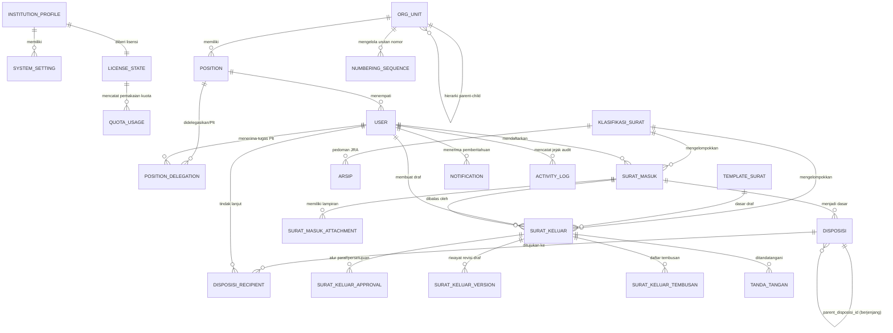

# Desain Basis Data E-Office (Single-Tenant)

Dokumen ini mendokumentasikan skema basis data, Entity Relationship Diagram (ERD), strategi indeks performa tinggi, serta aturan penguncian atomik dan integritas data untuk sistem E-Office.

---

## 1. Prinsip Utama Skema Basis Data

1. **Target Basis Data Tunggal: PostgreSQL:**
   * Basis data utama yang digunakan adalah **PostgreSQL 15+**.
   * Memanfaatkan tipe data bawaan `JSONB` untuk konfigurasi dinamis/kamus istilah, serta `tsvector` + GIN Index untuk pencarian full-text berkecepatan tinggi.
   * Catatan fallback untuk lingkungan non-PostgreSQL (seperti MySQL untuk server alternatif) dicatat terpisah di `docs/OPEN_QUESTIONS.md`.
2. **Tanpa `tenant_id`:** Basis data didedikasikan 100% untuk satu instansi. Tidak ada partisi tenant pada level tabel.
3. **Pemisahan Peran (`roles`) vs Jabatan (`positions`):**
   * **`roles` (Otorisasi Akses Sistem):** Menentukan hak teknis pengguna dalam aplikasi (misal: apa tombol yang bisa diklik, hak membuat surat, menyetujui, mengelola lisensi).
   * **`positions` (Struktur Birokrasi & Wewenang Naskah):** Menentukan kedudukan pejabat dalam hierarki organisasi unit kerja (misal: Ketua Jurusan Elektro, Direktur). Menjadi dasar alur disposisi, rantai paraf, dan hak tanda tangan naskah dinas.
4. **Performa Tinggi (< 2 Detik pada 100.000 Surat):**
   * Semua foreign key memiliki indeks eksplisit.
   * Indeks komposit pada kombinasi status, tanggal, dan unit kerja untuk filter daftar surat.
   * Indeks GIN pada kolom pencarian teks.
5. **Pemberian Nomor Anti-Ganda:** Tabel `numbering_sequences` diproteksi menggunakan transaksi database dan *pessimistic row locking* (`SELECT ... FOR UPDATE`).
6. **Append-Only Audit Log:** Tabel `activity_logs` tidak mengizinkan pembaruan (`UPDATE`) maupun penghapusan (`DELETE`) melalui trigger database PostgreSQL dan model event.
7. **Integritas Arsip:** Surat yang telah diterbitkan nomornya **tidak boleh dihapus fisik** (`hard delete`), melainkan hanya dapat diubah statusnya menjadi `dibatalkan` disertai alasan dan jejak audit.

---

## 2. Pemisahan Tanggung Jawab: `roles` vs `positions`

Untuk menghindari kerancuan antara hak teknis aplikasi dan struktur birokrasi instansi, sistem memisahkan keduanya secara tegas:

```
+---------------------------------------------------------------------------------------+
| PENGGUNA (User: Dr. Ir. Budi, M.T.)                                                  |
+-------------------------------------------+-------------------------------------------+
| ROLES (Spatie Permission)                 | POSITIONS (Struktur Organisasi)           |
| -> Siapa yang mengoperasikan sistem?      | -> Apa jabatannya dalam tata naskah dinas? |
+-------------------------------------------+-------------------------------------------+
| Role: "Pimpinan"                          | Position: "Ketua Jurusan Mesin"           |
| Permissions:                              | Org Unit: "Jurusan Teknik Mesin" (JTM)    |
| - disposisi.create                        | Wewenang Surat:                           |
| - disposisi.forward                       | - Menerima disposisi untuk Jurusan Mesin  |
| - surat_keluar.review                     | - Memaraf naskah dinas keluar dari JTM    |
| - surat_keluar.sign                       | - Menandatangani surat tugas lingkup JTM  |
|                                           | Delegasi: Dapat ditunjuk Plt saat cuti    |
+-------------------------------------------+-------------------------------------------+
```

* **Manfaat Pemisahan:**
  1. Jika Ketua Jurusan cuti, pendelegasian jabatan (`position_delegations`) dapat dialihkan ke Sekretaris Jurusan sebagai Plt tanpa perlu mengubah role sistem akun tersebut.
  2. Satu orang pejabat yang memegang dua posisi (misal Dosen dan Kaprodi) tetap memiliki akun dengan permissions yang bersih.

---

## 3. Entity Relationship Diagram (Mermaid)



---

## 4. Spesifikasi Tabel Utama (PostgreSQL)

### 4.1 Profil Instansi, Pengaturan, Lisensi & Pemantauan Kuota

#### `institution_profiles`
| Kolom | Tipe Data (PostgreSQL) | Keterangan |
|---|---|---|
| `id` | BIGSERIAL PRIMARY KEY | Identitas |
| `name` | VARCHAR(255) NOT NULL | Nama instansi resmi (contoh: "Politeknik Negeri Bandung") |
| `alias` | VARCHAR(50) NOT NULL | Singkatan nama instansi (contoh: "POLBAN") |
| `address` | TEXT NULL | Alamat kantor lengkap |
| `email` | VARCHAR(100) NULL | Email resmi tata usaha |
| `phone` | VARCHAR(50) NULL | Telepon / kontak |
| `website` | VARCHAR(100) NULL | Portal resmi instansi |
| `logo_path` | VARCHAR(255) NULL | Path file logo |
| `header_image_path`| VARCHAR(255) NULL | Path kop surat naskah dinas |
| `timezone` | VARCHAR(50) NOT NULL DEFAULT 'Asia/Jakarta' | Zona waktu (`Asia/Jakarta`, `Asia/Makassar`, `Asia/Jayapura`) |
| `default_theme` | VARCHAR(50) NOT NULL DEFAULT 'emerald' | Warna tema antarmuka |
| `terminology_dict` | JSONB NOT NULL DEFAULT '{}'::jsonb | Kamus istilah dinamis |
| `created_at`, `updated_at` | TIMESTAMPTZ | Waktu sistem |

#### `system_settings`
| Kolom | Tipe Data | Keterangan |
|---|---|---|
| `id` | BIGSERIAL PRIMARY KEY | Identitas |
| `key` | VARCHAR(100) NOT NULL UNIQUE | Kunci konfigurasi |
| `value` | JSONB NOT NULL | Nilai konfigurasi |
| `created_at`, `updated_at` | TIMESTAMPTZ | Waktu sistem |

#### `license_states`
| Kolom | Tipe Data | Keterangan |
|---|---|---|
| `id` | BIGSERIAL PRIMARY KEY | Identitas |
| `license_key` | VARCHAR(255) NOT NULL UNIQUE | Kunci lisensi terenkripsi |
| `institution_slug`| VARCHAR(100) NOT NULL | Identitas unik instansi |
| `plan` | VARCHAR(50) NOT NULL DEFAULT 'standar' | `dasar`, `standar`, `lanjutan` |
| `status` | VARCHAR(50) NOT NULL DEFAULT 'active' | `active`, `grace_period`, `expired` |
| `expires_at` | TIMESTAMPTZ NOT NULL | Tanggal akhir masa berlaku |
| `grace_period_days`| INT NOT NULL DEFAULT 14 | Masa tenggang setelah expired |
| `max_users` | INT NOT NULL DEFAULT 100 | Batas kuota pengguna aktif |
| `max_storage_bytes`| BIGINT NOT NULL DEFAULT 53687091200 | Batas kuota penyimpanan (bytes) |
| `active_features` | JSONB NOT NULL DEFAULT '{}'::jsonb | Entitlement fitur (ocr, tte, whatsapp, sso, api) |
| `last_verified_at`| TIMESTAMPTZ NOT NULL | Waktu verifikasi terakhir |
| `signature_hash` | TEXT NOT NULL | Validasi hash tanda tangan lisensi |
| `created_at`, `updated_at` | TIMESTAMPTZ | Waktu sistem |

#### `quota_usages` (Pencatatan Pemakaian Storage & User)
| Kolom | Tipe Data | Keterangan |
|---|---|---|
| `id` | BIGSERIAL PRIMARY KEY | Identitas |
| `recorded_at` | TIMESTAMPTZ NOT NULL | Waktu snapshot kuota |
| `active_users_count` | INT NOT NULL | Jumlah user aktif saat pencatatan |
| `storage_used_bytes` | BIGINT NOT NULL | Total bytes file storage yang digunakan |
| `files_count` | BIGINT NOT NULL | Total jumlah berkas yang tersimpan |
| `details` | JSONB NULL | Rincian per modul (misal: storage surat masuk vs keluar) |
| `created_at` | TIMESTAMPTZ NOT NULL DEFAULT NOW() | Waktu pencatatan |

---

### 4.2 Struktur Organisasi, Jabatan, Delegasi & Pengguna

#### `org_units`
| Kolom | Tipe Data | Keterangan |
|---|---|---|
| `id` | BIGSERIAL PRIMARY KEY | Identitas |
| `parent_id` | BIGINT NULL REFERENCES org_units(id) ON DELETE SET NULL | Hierarki unit |
| `name` | VARCHAR(255) NOT NULL | Nama unit kerja (mis: "Jurusan Teknik Sipil") |
| `code` | VARCHAR(50) NOT NULL UNIQUE | Kode unit penomoran surat (mis: "JTS") |
| `type` | VARCHAR(50) NOT NULL | Tipe unit: `pimpinan`, `jurusan`, `prodi`, `bagian`, `unit_pelaksana` |
| `order_index` | INT NOT NULL DEFAULT 0 | Urutan susunan organisasi |
| `created_at`, `updated_at` | TIMESTAMPTZ | Waktu sistem |

#### `positions`
| Kolom | Tipe Data | Keterangan |
|---|---|---|
| `id` | BIGSERIAL PRIMARY KEY | Identitas |
| `org_unit_id` | BIGINT NOT NULL REFERENCES org_units(id) ON DELETE CASCADE | Unit pemilik jabatan |
| `name` | VARCHAR(255) NOT NULL | Nama jabatan (mis: "Ketua Jurusan", "Sekretaris Jurusan") |
| `level` | INT NOT NULL DEFAULT 1 | Level hierarki vertikal |
| `is_penandatangan` | BOOLEAN NOT NULL DEFAULT FALSE | Berwenang menandatangani naskah keluar |
| `created_at`, `updated_at` | TIMESTAMPTZ | Waktu sistem |

#### `position_delegations` (Delegasi Wewenang / Plt)
| Kolom | Tipe Data | Keterangan |
|---|---|---|
| `id` | BIGSERIAL PRIMARY KEY | Identitas |
| `position_id` | BIGINT NOT NULL REFERENCES positions(id) ON DELETE CASCADE | Jabatan yang didelegasikan |
| `original_user_id` | BIGINT NOT NULL REFERENCES users(id) ON DELETE CASCADE | Pejabat definitif |
| `delegate_user_id` | BIGINT NOT NULL REFERENCES users(id) ON DELETE CASCADE | Pejabat Plt/Penerima tugas |
| `start_date` | DATE NOT NULL | Tanggal mulai berlaku |
| `end_date` | DATE NOT NULL | Tanggal akhir berlaku |
| `reason` | TEXT NOT NULL | Alasan penugasan (dinas luar, cuti) |
| `surat_tugas_number` | VARCHAR(100) NULL | Nomor surat tugas penunjukan Plt |
| `is_active` | BOOLEAN NOT NULL DEFAULT TRUE | Status keaktifan delegasi |
| `created_at`, `updated_at` | TIMESTAMPTZ | Waktu sistem |

#### `users`
| Kolom | Tipe Data | Keterangan |
|---|---|---|
| `id` | BIGSERIAL PRIMARY KEY | Identitas |
| `name` | VARCHAR(255) NOT NULL | Nama lengkap |
| `nip` | VARCHAR(50) NULL UNIQUE | NIP / Identitas kepegawaian |
| `email` | VARCHAR(191) NOT NULL UNIQUE | Email resmi |
| `password` | VARCHAR(255) NOT NULL | Hash password argon2id/bcrypt |
| `position_id` | BIGINT NULL REFERENCES positions(id) ON DELETE SET NULL | Posisi jabatan utama |
| `phone` | VARCHAR(50) NULL | Nomor kontak/WhatsApp |
| `is_active` | BOOLEAN NOT NULL DEFAULT TRUE | Status keaktifan akun |
| `signature_image_path` | VARCHAR(255) NULL | Path berkas pindaian tanda tangan |
| `two_factor_secret` | TEXT NULL | Secret 2FA TOTP |
| `remember_token` | VARCHAR(100) NULL | Token sesi |
| `created_at`, `updated_at` | TIMESTAMPTZ | Waktu sistem |

---

### 4.3 Surat Masuk & Disposisi Berjenjang

#### `surat_masuk`
| Kolom | Tipe Data | Keterangan |
|---|---|---|
| `id` | BIGSERIAL PRIMARY KEY | Identitas |
| `nomor_agenda` | VARCHAR(50) NOT NULL UNIQUE | Format agenda tahunan unik (mis: `SM-2026-0001`) |
| `nomor_surat_asal` | VARCHAR(100) NOT NULL | Nomor surat yang tertera dari pengirim |
| `pengirim` | VARCHAR(255) NOT NULL | Instansi / nama pengirim |
| `tanggal_surat` | DATE NOT NULL | Tanggal naskah surat asal |
| `tanggal_terima` | DATE NOT NULL | Tanggal diterima di instansi |
| `perihal` | TEXT NOT NULL | Pokok isi surat |
| `sifat` | VARCHAR(50) NOT NULL DEFAULT 'biasa' | `biasa`, `penting`, `segera`, `rahasia` |
| `jenis` | VARCHAR(50) NOT NULL DEFAULT 'umum' | `undangan`, `edaran`, `permohonan`, `umum` |
| `klasifikasi_id` | BIGINT NOT NULL REFERENCES klasifikasi_surat(id) | Kode klasifikasi arsip |
| `status` | VARCHAR(50) NOT NULL DEFAULT 'terdaftar' | `draft_registrasi`, `terdaftar`, `menunggu_disposisi`, `didisposisi`, `diproses`, `selesai`, `diarsipkan`, `dibatalkan` |
| `confidentiality` | VARCHAR(50) NOT NULL DEFAULT 'umum' | `umum`, `terbatas`, `rahasia` |
| `alasan_batal` | TEXT NULL | Alasan jika surat dibatalkan |
| `pendaftar_id` | BIGINT NOT NULL REFERENCES users(id) | Petugas pencatat surat |
| `qr_token` | VARCHAR(64) NOT NULL UNIQUE | Token verifikasi lembar disposisi |
| `created_at`, `updated_at`, `deleted_at` | TIMESTAMPTZ | Soft delete didukung |

#### `disposisi` (Disposisi Berjenjang)
| Kolom | Tipe Data | Keterangan |
|---|---|---|
| `id` | BIGSERIAL PRIMARY KEY | Identitas disposisi |
| `surat_masuk_id` | BIGINT NOT NULL REFERENCES surat_masuk(id) ON DELETE CASCADE | Surat masuk yang didisposisikan |
| `parent_disposisi_id`| BIGINT NULL REFERENCES disposisi(id) ON DELETE CASCADE | **Relasi induk (berjenjang)**: NULL untuk disposisi tingkat 1 dari Pimpinan Utama; terisi ID induk saat pejabat di bawahnya meneruskan instruksi ke unit/stafnya |
| `pemberi_id` | BIGINT NOT NULL REFERENCES users(id) | Pejabat pemberi instruksi disposisi |
| `pemberi_position_id`| BIGINT NOT NULL REFERENCES positions(id) | Posisi jabatan saat mendisposisikan |
| `instruksi` | TEXT NOT NULL | Instruksi tindakan |
| `catatan` | TEXT NULL | Catatan khusus dari pemberi |
| `prioritas` | VARCHAR(50) NOT NULL DEFAULT 'biasa' | `biasa`, `segera`, `sangat_segera` |
| `tenggat_waktu` | DATE NULL | Batas waktu tindak lanjut |
| `created_at`, `updated_at` | TIMESTAMPTZ | Waktu sistem |

#### `disposisi_recipients`
| Kolom | Tipe Data | Keterangan |
|---|---|---|
| `id` | BIGSERIAL PRIMARY KEY | Identitas penerima disposisi |
| `disposisi_id` | BIGINT NOT NULL REFERENCES disposisi(id) ON DELETE CASCADE | Relasi ke instruksi disposisi |
| `recipient_user_id` | BIGINT NULL REFERENCES users(id) ON DELETE SET NULL | Penerima personal |
| `recipient_unit_id` | BIGINT NULL REFERENCES org_units(id) ON DELETE SET NULL | Penerima unit kerja |
| `status` | VARCHAR(50) NOT NULL DEFAULT 'menunggu' | `menunggu`, `dibaca`, `sedang_diproses`, `selesai` |
| `read_at` | TIMESTAMPTZ NULL | Waktu pertama dibuka |
| `completed_at` | TIMESTAMPTZ NULL | Waktu selesai ditindaklanjuti |
| `catatan_tindak_lanjut`| TEXT NULL | Uraian hasil pelaksanaan |
| `bukti_path` | VARCHAR(255) NULL | Path file bukti penyelesaian |
| `surat_keluar_id` | BIGINT NULL REFERENCES surat_keluar(id) ON DELETE SET NULL | Tautan surat keluar balasan |
| `created_at`, `updated_at` | TIMESTAMPTZ | Waktu sistem |

---

### 4.4 Surat Keluar, Persetujuan, Tembusan & Pengiriman

#### `surat_keluar`
| Kolom | Tipe Data | Keterangan |
|---|---|---|
| `id` | BIGSERIAL PRIMARY KEY | Identitas |
| `nomor_surat` | VARCHAR(100) NULL UNIQUE | Nomor resmi surat (diterbitkan saat disetujui penuh) |
| `template_id` | BIGINT NULL REFERENCES template_surat(id) | Template naskah yang dipakai |
| `klasifikasi_id` | BIGINT NOT NULL REFERENCES klasifikasi_surat(id) | Kode klasifikasi arsip |
| `org_unit_id` | BIGINT NOT NULL REFERENCES org_units(id) | Unit asal pembuat surat |
| `pembuat_id` | BIGINT NOT NULL REFERENCES users(id) | Staf penyusun draf |
| `penandatangan_id`| BIGINT NOT NULL REFERENCES users(id) | Pejabat penandatangan akhir |
| `reply_to_surat_masuk_id` | BIGINT NULL REFERENCES surat_masuk(id) | Referensi surat masuk jika merupakan balasan |
| `perihal` | TEXT NOT NULL | Pokok naskah dinas |
| `isi_surat` | TEXT NOT NULL | Konten surat (rich text / HTML) |
| `sifat` | VARCHAR(50) NOT NULL DEFAULT 'biasa' | `biasa`, `penting`, `segera`, `rahasia` |
| `status` | VARCHAR(50) NOT NULL DEFAULT 'draf' | `draf`, `diajukan`, `dalam_pemeriksaan`, `perlu_revisi`, `disetujui`, `bernomor`, `menunggu_ttd`, `ditandatangani`, `terkirim`, `diarsipkan`, `ditolak`, `dibatalkan` |
| `tujuan` | JSONB NOT NULL DEFAULT '[]'::jsonb | Daftar penerima utama naskah |
| `qr_token` | VARCHAR(64) NOT NULL UNIQUE | Token publik verifikasi keaslian dokumen |
| `alasan_batal` | TEXT NULL | Keterangan jika surat bernomor dibatalkan |
| `tanggal_kirim` | TIMESTAMPTZ NULL | Waktu pengiriman resmi |
| `kanal_pengiriman`| VARCHAR(50) NULL | `email`, `pos`, `kurir`, `manual` |
| `resi_pengiriman` | VARCHAR(100) NULL | Nomor resi/tanda terima pengiriman |
| `created_at`, `updated_at`, `deleted_at` | TIMESTAMPTZ | Soft delete didukung |

#### `surat_keluar_tembusan` (Daftar Tembusan Surat Keluar)
| Kolom | Tipe Data | Keterangan |
|---|---|---|
| `id` | BIGSERIAL PRIMARY KEY | Identitas |
| `surat_keluar_id` | BIGINT NOT NULL REFERENCES surat_keluar(id) ON DELETE CASCADE | Surat terkait |
| `recipient_type` | VARCHAR(50) NOT NULL | `internal_unit`, `internal_position`, `external` |
| `target_unit_id` | BIGINT NULL REFERENCES org_units(id) | Terisi bila tembusan ke unit internal |
| `target_position_id`| BIGINT NULL REFERENCES positions(id) | Terisi bila tembusan ke jabatan tertentu |
| `external_name` | VARCHAR(255) NULL | Nama tembusan pihak eksternal |
| `order_index` | INT NOT NULL DEFAULT 1 | Urutan daftar tembusan |
| `created_at` | TIMESTAMPTZ NOT NULL DEFAULT NOW() | Waktu pencatatan |

---

### 4.5 Notifikasi & Jejak Audit

#### `notifications` (Notifikasi Pengguna)
| Kolom | Tipe Data | Keterangan |
|---|---|---|
| `id` | UUID PRIMARY KEY | ID UUID standar Laravel Notification |
| `type` | VARCHAR(255) NOT NULL | Class notifikasi (mis: `App\Notifications\DisposisiBaru`) |
| `notifiable_type` | VARCHAR(255) NOT NULL | Model penerima (`App\Domain\Pengguna\Models\User`) |
| `notifiable_id` | BIGINT NOT NULL | ID user penerima |
| `data` | JSONB NOT NULL | Payload notifikasi (judul, isi, link, aksi) |
| `read_at` | TIMESTAMPTZ NULL | Waktu dibaca |
| `created_at`, `updated_at` | TIMESTAMPTZ | Waktu sistem |

#### `activity_logs` (Append-Only)
| Kolom | Tipe Data | Keterangan |
|---|---|---|
| `id` | BIGSERIAL PRIMARY KEY | Identitas urut |
| `causer_id` | BIGINT NULL REFERENCES users(id) ON DELETE SET NULL | Pelaku aksi |
| `action` | VARCHAR(100) NOT NULL | Kode aksi (mis: `surat_masuk.created`, `surat_keluar.approved`) |
| `subject_type` | VARCHAR(100) NOT NULL | Model sasaran |
| `subject_id` | BIGINT NOT NULL | ID objek sasaran |
| `description` | TEXT NOT NULL | Narasi keterangan aktivitas |
| `properties` | JSONB NOT NULL DEFAULT '{}'::jsonb | Snapshot data sebelum vs sesudah |
| `ip_address` | VARCHAR(45) NULL | Alamat IP pemanggil |
| `user_agent` | TEXT NULL | Browser dan informasi perangkat |
| `created_at` | TIMESTAMPTZ NOT NULL DEFAULT NOW() | Waktu pencatatan (tanpa `updated_at`) |

---

## 5. Proteksi Append-Only pada `activity_logs` (Trigger PostgreSQL)

Di samping pembatasan di level Model Eloquent, PostgreSQL mengunci tabel `activity_logs` melalui trigger database berikut:

```sql
CREATE OR REPLACE FUNCTION prevent_activity_logs_modification()
RETURNS TRIGGER AS $$
BEGIN
    RAISE EXCEPTION 'TABEL activity_logs BERSIFAT APPEND-ONLY: Operasi UPDATE dan DELETE dilarang.';
END;
$$ LANGUAGE plpgsql;

CREATE TRIGGER trg_activity_logs_no_update_delete
BEFORE UPDATE OR DELETE ON activity_logs
FOR EACH ROW
EXECUTE FUNCTION prevent_activity_logs_modification();
```

---

## 6. Strategi Indeks & Performa Tinggi (PostgreSQL GIN & Composite)

```sql
-- Filter cepat Surat Masuk
CREATE INDEX idx_surat_masuk_status_date ON surat_masuk (status, tanggal_terima DESC, klasifikasi_id);
CREATE INDEX idx_surat_masuk_agenda ON surat_masuk (nomor_agenda);
CREATE INDEX idx_surat_masuk_fts ON surat_masuk USING gin(to_tsvector('indonesian', perihal || ' ' || pengirim));

-- Filter cepat Surat Keluar
CREATE INDEX idx_surat_keluar_status_unit ON surat_keluar (status, org_unit_id, created_at DESC);
CREATE INDEX idx_surat_keluar_penandatangan ON surat_keluar (penandatangan_id, status);
CREATE INDEX idx_surat_keluar_fts ON surat_keluar USING gin(to_tsvector('indonesian', perihal || ' ' || isi_surat));

-- Disposisi berjenjang & penerima
CREATE INDEX idx_disposisi_parent ON disposisi (parent_disposisi_id);
CREATE INDEX idx_disposisi_surat ON disposisi (surat_masuk_id);
CREATE INDEX idx_disposisi_recipient_user_status ON disposisi_recipients (recipient_user_id, status);

-- Delegasi wewenang aktif
CREATE INDEX idx_delegations_active ON position_delegations (position_id, start_date, end_date) WHERE is_active = TRUE;
```
