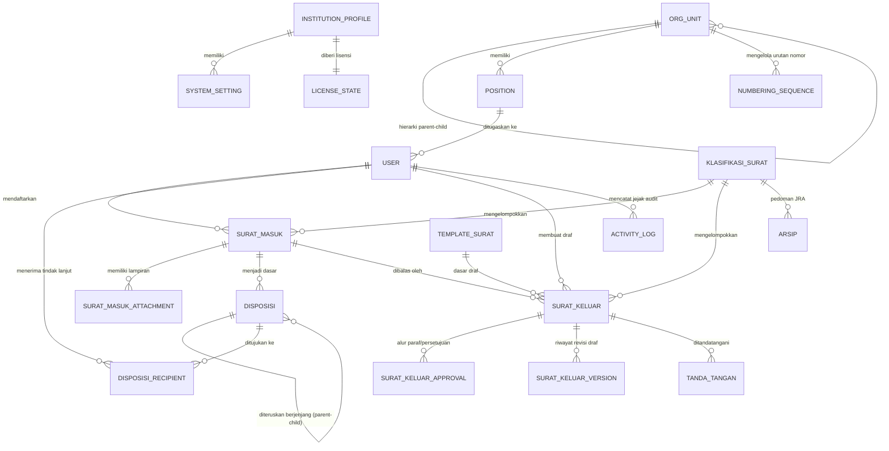

# Desain Basis Data E-Office (Single-Tenant)

Dokumen ini mendokumentasikan skema basis data, Entity Relationship Diagram (ERD), strategi indeks performa tinggi, serta aturan penguncian atomik dan integritas data untuk sistem E-Office.

---

## 1. Prinsip Utama Skema Basis Data

1. **Tanpa `tenant_id`:** Basis data didedikasikan 100% untuk satu instansi. Tidak ada partisi tenant pada level tabel.
2. **Performa Tinggi (< 2 Detik pada 100.000 Surat):**
   * Semua foreign key diindeks.
   * Indeks komposit pada kombinasi status, tanggal, dan unit kerja untuk filter daftar surat.
   * Dukungan full-text search (PostgreSQL `tsvector` + GIN Index, atau fallback MySQL `FULLTEXT`).
3. **Pemberian Nomor Anti-Ganda:** Tabel `numbering_sequences` diproteksi menggunakan transaksi database dan *pessimistic row locking* (`SELECT ... FOR UPDATE`).
4. **Append-Only Audit Log:** Tabel `activity_logs` tidak mengizinkan pembaruan (`UPDATE`) maupun penghapusan (`DELETE`).
5. **Integritas Arsip:** Surat yang telah diterbitkan nomornya **tidak boleh dihapus fisik** (`hard delete`), melainkan hanya dapat diubah statusnya menjadi `dibatalkan` disertai alasan dan jejak audit.

---

## 2. Entity Relationship Diagram (Mermaid)



---

## 3. Spesifikasi Tabel Utama

### 3.1 Profil Instansi, Pengaturan & Lisensi

#### `institution_profiles`
Menyimpan konfigurasi utama instansi (hanya 1 baris record aktif).
| Kolom | Tipe Data | Keterangan |
|---|---|---|
| `id` | BIGINT PK | Identitas |
| `name` | VARCHAR(255) | Nama instansi resmi (contoh: "Politeknik Negeri XYZ") |
| `alias` | VARCHAR(50) | Singkatan instansi |
| `address` | TEXT | Alamat lengkap kantor |
| `email` | VARCHAR(100) | Email resmi tata usaha |
| `phone` | VARCHAR(50) | Nomor kontak/telepon |
| `website` | VARCHAR(100) | Alamat portal web |
| `logo_path` | VARCHAR(255) | Path file logo instansi |
| `header_image_path` | VARCHAR(255) | Path kop surat resmi |
| `timezone` | VARCHAR(50) | Zona waktu (`Asia/Jakarta`, `Asia/Makassar`, `Asia/Jayapura`) |
| `default_theme` | VARCHAR(50) | Tema warna UI instansi |
| `terminology_dict` | JSONB / JSON | Kamus istilah dinamis (mis: `{"unit_level_1": "Jurusan", "lead_level_1": "Ketua Jurusan"}`) |
| `created_at`, `updated_at` | TIMESTAMP | Waktu sistem |

#### `system_settings`
Pengaturan fleksibel berbasis key-value.
| Kolom | Tipe Data | Keterangan |
|---|---|---|
| `key` | VARCHAR(100) UNIQUE | Kunci konfigurasi (mis: `numbering_format_default`, `max_upload_size`) |
| `value` | JSONB / TEXT | Nilai konfigurasi |
| `created_at`, `updated_at` | TIMESTAMP | Waktu sistem |

#### `license_states`
Status lisensi single-tenant dan kuota paket berlangganan.
| Kolom | Tipe Data | Keterangan |
|---|---|---|
| `id` | BIGINT PK | Identitas |
| `license_key` | VARCHAR(255) UNIQUE | Kunci lisensi terenkripsi |
| `institution_slug` | VARCHAR(100) | Identitas instansi pada server vendor |
| `plan` | VARCHAR(50) | Paket: `dasar`, `standar`, `lanjutan` |
| `status` | VARCHAR(50) | Status: `active`, `grace_period`, `expired` |
| `expires_at` | TIMESTAMP | Tanggal masa berlaku berakhir |
| `grace_period_days` | INT | Masa toleransi setelah expired (default: 14 hari) |
| `max_users` | INT | Batas pengguna aktif (kuota paket) |
| `max_storage_mb` | INT | Batas kapasitas penyimpanan (MB) |
| `active_features` | JSONB / JSON | Entitlement fitur (OCR, TTE, WhatsApp, SSO, API) |
| `last_verified_at`| TIMESTAMP | Waktu terakhir validasi ke server vendor |
| `signature_hash` | TEXT | Tanda tangan digital validasi lisensi offline/online |
| `created_at`, `updated_at` | TIMESTAMP | Waktu sistem |

---

### 3.2 Struktur Organisasi & Pengguna

#### `org_units`
Hierarki unit kerja (Instansi $\rightarrow$ Bagian/Jurusan $\rightarrow$ Subbagian/Prodi).
| Kolom | Tipe Data | Keterangan |
|---|---|---|
| `id` | BIGINT PK | Identitas |
| `parent_id` | BIGINT NULL FK | Relasi ke `org_units.id` (self-referencing) |
| `name` | VARCHAR(255) | Nama unit (contoh: "Teknik Informatika", "Bagian Umum") |
| `code` | VARCHAR(50) UNIQUE | Kode unit untuk penomoran surat (contoh: "TI", "BU") |
| `type` | VARCHAR(50) | Tipe unit (contoh: `pimpinan`, `jurusan`, `prodi`, `biro`) |
| `order_index` | INT | Urutan tampilan |
| `created_at`, `updated_at` | TIMESTAMP | Waktu sistem |

#### `positions`
Master jabatan yang ada dalam instansi.
| Kolom | Tipe Data | Keterangan |
|---|---|---|
| `id` | BIGINT PK | Identitas |
| `org_unit_id` | BIGINT FK | Relasi ke `org_units.id` |
| `name` | VARCHAR(255) | Nama jabatan (contoh: "Direktur", "Ketua Jurusan", "Staf TU") |
| `level` | INT | Tingkat hierarki wewenang (1: Pimpinan Tertinggi, 2: Pimpinan Unit, dst) |
| `is_penandatangan` | BOOLEAN | Apakah berwenang menandatangani surat resmi |
| `created_at`, `updated_at` | TIMESTAMP | Waktu sistem |

#### `users`
Tabel pengguna aplikasi.
| Kolom | Tipe Data | Keterangan |
|---|---|---|
| `id` | BIGINT PK | Identitas |
| `name` | VARCHAR(255) | Nama lengkap beserta gelar |
| `nip` | VARCHAR(50) NULL | Nomor Induk Pegawai |
| `email` | VARCHAR(191) UNIQUE | Email resmi pengguna |
| `password` | VARCHAR(255) | Hash password |
| `position_id` | BIGINT NULL FK | Relasi ke jabatan utama `positions.id` |
| `phone` | VARCHAR(50) NULL | Nomor WhatsApp / kontak |
| `is_active` | BOOLEAN | Status keaktifan (default: `true`) |
| `signature_image_path` | VARCHAR(255) NULL | File tanda tangan basah pindaian |
| `two_factor_secret` | TEXT NULL | Secret 2FA TOTP |
| `remember_token` | VARCHAR(100) NULL | Token autentikasi |
| `created_at`, `updated_at` | TIMESTAMP | Waktu sistem |

*(Catatan: RBAC menggunakan tabel standar `spatie/laravel-permission`: `roles`, `permissions`, `model_has_roles`, `model_has_permissions`).*

---

### 3.3 Klasifikasi Arsip

#### `klasifikasi_surat`
Kode klasifikasi dan pedoman retensi surat dinamis.
| Kolom | Tipe Data | Keterangan |
|---|---|---|
| `id` | BIGINT PK | Identitas |
| `kode` | VARCHAR(50) UNIQUE | Kode klasifikasi (contoh: `KP.01.02`, `HK.02`) |
| `nama` | VARCHAR(255) | Deskripsi (contoh: "Penerimaan Pegawai", "Perjanjian Kerjasama") |
| `parent_id` | BIGINT NULL FK | Relasi hirarki kode klasifikasi |
| `retensi_aktif` | INT | Masa simpan aktif (dalam tahun) |
| `retensi_inaktif` | INT | Masa simpan inaktif (dalam tahun) |
| `nasib_akhir` | VARCHAR(50) | `permanen`, `musnah`, `nilai_guna` |
| `created_at`, `updated_at` | TIMESTAMP | Waktu sistem |

---

### 3.4 Surat Masuk & Disposisi

#### `surat_masuk`
Pencatatan registrasi surat masuk.
| Kolom | Tipe Data | Keterangan |
|---|---|---|
| `id` | BIGINT PK | Identitas |
| `nomor_agenda` | VARCHAR(50) | Nomor urut agenda tahunan (contoh: `AG-2026-0001`) |
| `nomor_surat_asal` | VARCHAR(100) | Nomor surat yang tertera dari pengirim |
| `pengirim` | VARCHAR(255) | Nama instansi / pihak pengirim |
| `tanggal_surat` | DATE | Tanggal yang tertera pada surat asal |
| `tanggal_terima` | DATE | Tanggal surat diterima oleh instansi |
| `perihal` | TEXT | Ringkasan pokok isi surat |
| `sifat` | VARCHAR(50) | `biasa`, `penting`, `segera`, `rahasia` |
| `jenis` | VARCHAR(50) | `undangan`, `edaran`, `permohonan`, `lainnya` |
| `klasifikasi_id` | BIGINT FK | Relasi ke `klasifikasi_surat.id` |
| `status` | VARCHAR(50) | `draft_registrasi`, `terdaftar`, `menunggu_disposisi`, `didisposisi`, `diproses`, `selesai`, `diarsipkan`, `dibatalkan` |
| `confidentiality` | VARCHAR(50) | `umum`, `terbatas`, `rahasia` |
| `alasan_batal` | TEXT NULL | Wajib diisi bila status `dibatalkan` |
| `pendaftar_id` | BIGINT FK | Relasi ke `users.id` (petugas TU yang mendaftarkan) |
| `qr_token` | VARCHAR(64) UNIQUE | Token unik verifikasi fisik lembar disposisi |
| `created_at`, `updated_at`, `deleted_at` | TIMESTAMP | Soft deletes didukung |

#### `surat_masuk_attachments`
File pindaian surat masuk dan lampiran.
| Kolom | Tipe Data | Keterangan |
|---|---|---|
| `id` | BIGINT PK | Identitas |
| `surat_masuk_id` | BIGINT FK | Relasi ke `surat_masuk.id` |
| `file_name` | VARCHAR(255) | Nama file asli |
| `file_path` | VARCHAR(255) | Lokasi penyimpanan file (disk aman) |
| `mime_type` | VARCHAR(100) | Format mime (PDF/JPG/PNG) |
| `file_size` | BIGINT | Ukuran dalam bytes |
| `ocr_text` | TEXT NULL | Teks hasil ekstraksi OCR untuk pencarian full-text |
| `created_at`, `updated_at` | TIMESTAMP | Waktu sistem |

#### `disposisi`
Header instruksi disposisi dari pimpinan / atasan.
| Kolom | Tipe Data | Keterangan |
|---|---|---|
| `id` | BIGINT PK | Identitas |
| `surat_masuk_id` | BIGINT FK | Relasi ke `surat_masuk.id` |
| `parent_id` | BIGINT NULL FK | Relasi ke `disposisi.id` (untuk disposisi berjenjang) |
| `pemberi_id` | BIGINT FK | Relasi ke `users.id` (pimpinan / pejabat pemberi disposisi) |
| `instruksi` | TEXT | Petunjuk tindakan (contoh: "Tindak lanjuti segera", "Pelajari") |
| `catatan` | TEXT NULL | Catatan tambahan khusus |
| `prioritas` | VARCHAR(50) | `biasa`, `segera`, `sangat_segera` |
| `tenggat_waktu` | DATE NULL | Batas waktu tindak lanjut |
| `created_at`, `updated_at` | TIMESTAMP | Waktu sistem |

#### `disposisi_recipients`
Detail penerima disposisi dan status tindak lanjutnya.
| Kolom | Tipe Data | Keterangan |
|---|---|---|
| `id` | BIGINT PK | Identitas |
| `disposisi_id` | BIGINT FK | Relasi ke `disposisi.id` |
| `recipient_user_id`| BIGINT NULL FK | Relasi ke `users.id` |
| `recipient_unit_id`| BIGINT NULL FK | Relasi ke `org_units.id` (bila disposisi per unit) |
| `status` | VARCHAR(50) | `menunggu`, `dibaca`, `sedang_diproses`, `selesai` |
| `read_at` | TIMESTAMP NULL | Waktu pertama kali penerima membuka disposisi |
| `completed_at` | TIMESTAMP NULL | Waktu tindak lanjut diselesaikan |
| `catatan_tindak_lanjut` | TEXT NULL | Laporan hasil tindak lanjut |
| `bukti_path` | VARCHAR(255) NULL| File bukti penyelesaian |
| `surat_keluar_id` | BIGINT NULL FK | Tautan ke draf surat balasan (bila ada) |
| `created_at`, `updated_at` | TIMESTAMP | Waktu sistem |

---

### 3.5 Surat Keluar & Persetujuan (Approval)

#### `template_surat`
Template naskah dinas resmi.
| Kolom | Tipe Data | Keterangan |
|---|---|---|
| `id` | BIGINT PK | Identitas |
| `nama` | VARCHAR(255) | Nama template (mis: "Surat Tugas", "Nota Dinas", "Undangan") |
| `jenis` | VARCHAR(50) | Jenis surat terkait |
| `konten_html` | TEXT | Template body dengan placeholder `{nama}`, `{nip}`, `{perihal}` |
| `default_sifat` | VARCHAR(50) | Sifat bawaan template |
| `klasifikasi_id` | BIGINT NULL FK | Relasi bawaan ke `klasifikasi_surat.id` |
| `created_at`, `updated_at` | TIMESTAMP | Waktu sistem |

#### `surat_keluar`
Pencatatan naskah surat keluar.
| Kolom | Tipe Data | Keterangan |
|---|---|---|
| `id` | BIGINT PK | Identitas |
| `nomor_surat` | VARCHAR(100) NULL | Nomor resmi (diterbitkan setelah disetujui penuh) |
| `template_id` | BIGINT NULL FK | Relasi ke `template_surat.id` |
| `klasifikasi_id` | BIGINT FK | Relasi ke `klasifikasi_surat.id` |
| `org_unit_id` | BIGINT FK | Unit pembuat naskah (`org_units.id`) |
| `pembuat_id` | BIGINT FK | Relasi ke `users.id` (staf penyusun draf) |
| `penandatangan_id` | BIGINT FK | Relasi ke `users.id` (pejabat berwenang menandatangani) |
| `reply_to_surat_masuk_id` | BIGINT NULL FK | Menautkan bila surat keluar merupakan balasan |
| `perihal` | TEXT | Pokok isi surat |
| `isi_surat` | TEXT | Konten surat (HTML / rich text) |
| `sifat` | VARCHAR(50) | `biasa`, `penting`, `segera`, `rahasia` |
| `status` | VARCHAR(50) | `draf`, `diajukan`, `dalam_pemeriksaan`, `perlu_revisi`, `disetujui`, `bernomor`, `menunggu_ttd`, `ditandatangani`, `terkirim`, `diarsipkan`, `ditolak`, `dibatalkan` |
| `tujuan` | JSONB / TEXT | Daftar pihak tujuan surat |
| `tembusan` | JSONB / TEXT | Daftar tembusan internal / eksternal |
| `qr_token` | VARCHAR(64) UNIQUE | Token publik verifikasi keaslian surat |
| `alasan_batal` | TEXT NULL | Alasan pembatalan surat bernomor |
| `tanggal_kirim` | TIMESTAMP NULL | Waktu pengiriman resmi |
| `kanal_pengiriman` | VARCHAR(50) NULL | `email`, `pos`, `kurir`, `manual` |
| `resi_pengiriman` | VARCHAR(100) NULL | Nomor resi ekspedisi |
| `created_at`, `updated_at`, `deleted_at` | TIMESTAMP | Soft deletes |

#### `surat_keluar_approvals`
Log riwayat alur persetujuan dan paraf berjenjang.
| Kolom | Tipe Data | Keterangan |
|---|---|---|
| `id` | BIGINT PK | Identitas |
| `surat_keluar_id` | BIGINT FK | Relasi ke `surat_keluar.id` |
| `step_order` | INT | Urutan tahap pemeriksaan |
| `reviewer_id` | BIGINT FK | Relasi ke `users.id` (pemeriksa / penandatangan) |
| `action` | VARCHAR(50) | `diajukan`, `paraf`, `disetujui`, `revisi_diminta`, `ditolak` |
| `notes` | TEXT NULL | Catatan koreksi / alasan penolakan |
| `created_at` | TIMESTAMP | Waktu eksekusi aksi |

#### `surat_keluar_versions`
Menyimpan snapshot draf ketika ada permintaan revisi.
| Kolom | Tipe Data | Keterangan |
|---|---|---|
| `id` | BIGINT PK | Identitas |
| `surat_keluar_id` | BIGINT FK | Relasi ke `surat_keluar.id` |
| `version_number` | INT | Nomor revisi (1, 2, 3...) |
| `content_snapshot`| TEXT | Snapshot isi surat saat versi tersebut diajukan |
| `created_by` | BIGINT FK | Penyunting revisi |
| `created_at` | TIMESTAMP | Waktu simpan versi |

#### `numbering_sequences`
Tabel pengunci urutan nomor surat otomatis per tahun dan unit kerja.
| Kolom | Tipe Data | Keterangan |
|---|---|---|
| `id` | BIGINT PK | Identitas |
| `org_unit_id` | BIGINT FK | Unit pembuat nomor |
| `year` | INT | Tahun penomoran (contoh: 2026) |
| `format_pattern` | VARCHAR(255) | Pola format token (mis: `{urut}/{kode_unit}/{kode_klasifikasi}/{bulan_romawi}/{tahun}`) |
| `current_number` | INT | Counter angka terakhir yang digunakan |
| `updated_at` | TIMESTAMP | Waktu update |

*Index Unik: `UNIQUE(org_unit_id, year)`.*

#### `tanda_tangan`
Merekam jejak penandatanganan surat keluar.
| Kolom | Tipe Data | Keterangan |
|---|---|---|
| `id` | BIGINT PK | Identitas |
| `surat_keluar_id` | BIGINT FK | Relasi ke `surat_keluar.id` |
| `user_id` | BIGINT FK | Pejabat penandatangan |
| `tipe` | VARCHAR(50) | `basah` (unggah scan), `tte` (elektronik bersertifikat) |
| `provider` | VARCHAR(50) NULL | Penyedia TTE (contoh: BSrE, Privy, dummy) |
| `certificate_info`| JSONB NULL | Metadata sertifikat X.509 |
| `document_hash` | VARCHAR(128) | SHA-256 hash dokumen final untuk jaminan anti-pemalsuan |
| `signed_at` | TIMESTAMP | Waktu tanda tangan |

---

### 3.6 Kearsipan Dinamis & Log Audit

#### `arsip`
Penyimpanan metadata kearsipan.
| Kolom | Tipe Data | Keterangan |
|---|---|---|
| `id` | BIGINT PK | Identitas |
| `document_type` | VARCHAR(50) | `surat_masuk`, `surat_keluar`, `dokumen_internal` |
| `document_id` | BIGINT | ID dokumen terkait |
| `klasifikasi_id` | BIGINT FK | Relasi ke `klasifikasi_surat.id` |
| `physical_location`| VARCHAR(255) NULL| Lokasi fisik berkas (mis: "Gedung A, Rak 04, Box 12") |
| `retention_status`| VARCHAR(50) | `aktif`, `inaktif`, `siap_disusutkan`, `dimusnahkan`, `diserahkan` |
| `active_until` | DATE | Tanggal berakhir masa retensi aktif |
| `inactive_until` | DATE | Tanggal berakhir masa retensi inaktif |
| `archived_at` | TIMESTAMP | Waktu diarsipkan |

#### `activity_logs` (Append-Only)
Jejak audit seluruh aktivitas penting.
| Kolom | Tipe Data | Keterangan |
|---|---|---|
| `id` | BIGINT PK | Identitas urut |
| `causer_id` | BIGINT NULL FK | Relasi ke `users.id` (pelaku) |
| `action` | VARCHAR(100) | Aksi (mis: `surat_masuk.created`, `surat_keluar.approved`, `number.generated`) |
| `subject_type` | VARCHAR(100) | Model target (mis: `App\Domain\SuratMasuk\Models\SuratMasuk`) |
| `subject_id` | BIGINT | ID target |
| `description` | TEXT | Keterangan mudah dibaca |
| `properties` | JSONB / JSON | Snapshot data sebelum vs sesudah aksi |
| `ip_address` | VARCHAR(45) | Alamat IP pengguna |
| `user_agent` | TEXT | Browser / perangkat pengguna |
| `created_at` | TIMESTAMP | Waktu kejadian (append-only) |

---

## 4. Strategi Indeks & Performa Tinggi

Untuk memastikan waktu akses tetap **< 2 detik saat data mencapai 100.000 surat**:

1. **Indeks Komposit untuk Filter Daftar Surat Masuk:**
   ```sql
   CREATE INDEX idx_surat_masuk_filter ON surat_masuk (status, tanggal_terima DESC, klasifikasi_id);
   CREATE INDEX idx_surat_masuk_agenda ON surat_masuk (nomor_agenda);
   CREATE INDEX idx_surat_masuk_pendaftar ON surat_masuk (pendaftar_id, created_at DESC);
   ```
2. **Indeks Komposit untuk Filter Surat Keluar:**
   ```sql
   CREATE INDEX idx_surat_keluar_filter ON surat_keluar (status, org_unit_id, created_at DESC);
   CREATE INDEX idx_surat_keluar_penandatangan ON surat_keluar (penandatangan_id, status);
   ```
3. **Indeks Disposisi:**
   ```sql
   CREATE INDEX idx_disposisi_recipients_user ON disposisi_recipients (recipient_user_id, status, created_at DESC);
   CREATE INDEX idx_disposisi_surat ON disposisi (surat_masuk_id);
   ```
4. **Indeks Full-Text Search (Pencarian Cepat):**
   * PostgreSQL:
     ```sql
     CREATE INDEX idx_surat_masuk_fts ON surat_masuk USING gin(to_tsvector('indonesian', perihal || ' ' || pengirim));
     CREATE INDEX idx_surat_keluar_fts ON surat_keluar USING gin(to_tsvector('indonesian', perihal || ' ' || isi_surat));
     ```
   * MySQL:
     ```sql
     ALTER TABLE surat_masuk ADD FULLTEXT idx_surat_masuk_ft (perihal, pengirim);
     ALTER TABLE surat_keluar ADD FULLTEXT idx_surat_keluar_ft (perihal, isi_surat);
     ```

---

## 5. Strategi Transaksi & Row-Locking (Penomoran Surat Anti-Ganda)

Penerbitan nomor surat resmi wajib diisolasi di dalam database transaction dengan `lockForUpdate()`:

```php
DB::transaction(function () use ($unitId, $year, $formatPattern, $klasifikasiCode) {
    // Kunci baris urutan nomor untuk unit & tahun ini secara eksklusif
    $sequence = NumberingSequence::where('org_unit_id', $unitId)
        ->where('year', $year)
        ->lockForUpdate()
        ->first();

    if (!$sequence) {
        $sequence = NumberingSequence::create([
            'org_unit_id'    => $unitId,
            'year'           => $year,
            'format_pattern' => $formatPattern,
            'current_number' => 0,
        ]);
        // Re-lock
        $sequence = NumberingSequence::where('id', $sequence->id)->lockForUpdate()->first();
    }

    $sequence->current_number += 1;
    $sequence->save();

    // Format nomor sesuai token
    $nomorSurat = NumberingService::formatToken(
        $sequence->format_pattern,
        $sequence->current_number,
        $unitCode,
        $klasifikasiCode,
        $year
    );

    return $nomorSurat;
});
```
Dengan strategi ini, dua proses approval yang selesai pada milidetik yang sama dijamin mendapatkan urutan nomor berurutan tanpa risiko duplikasi atau race condition.
